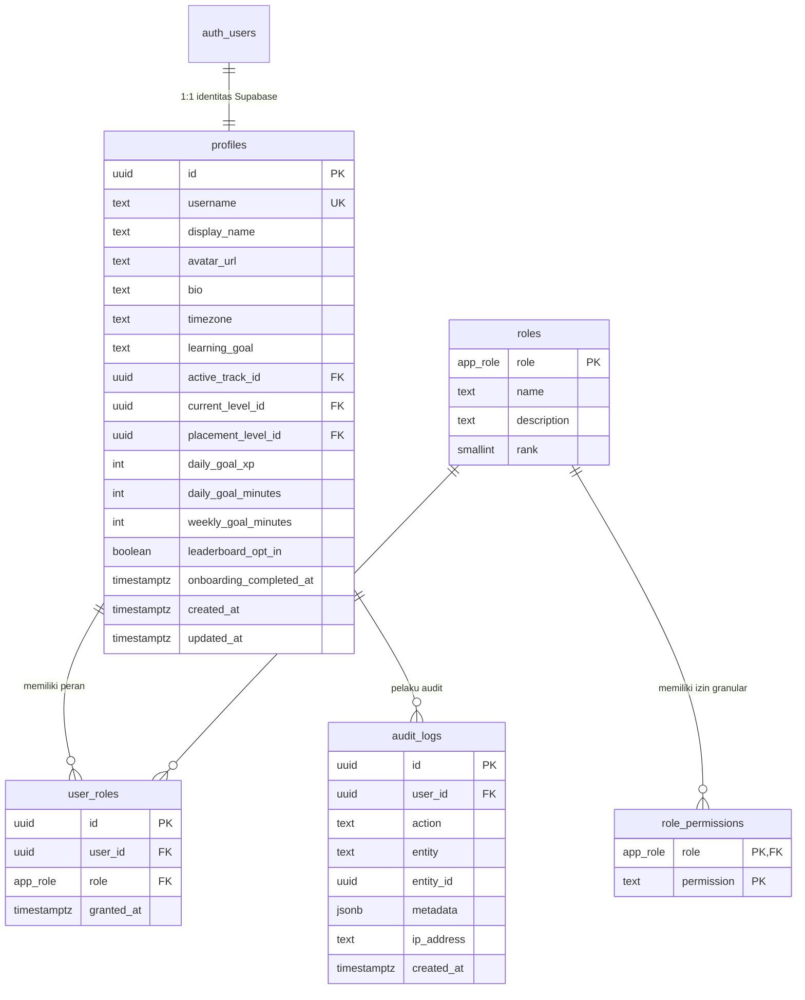
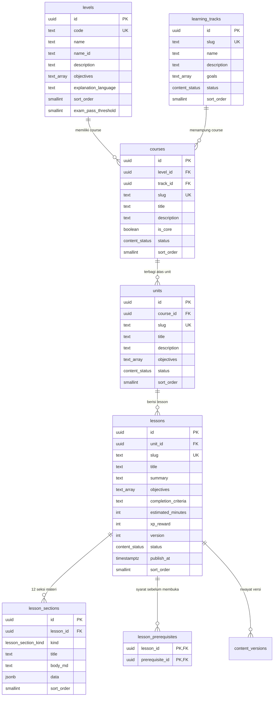
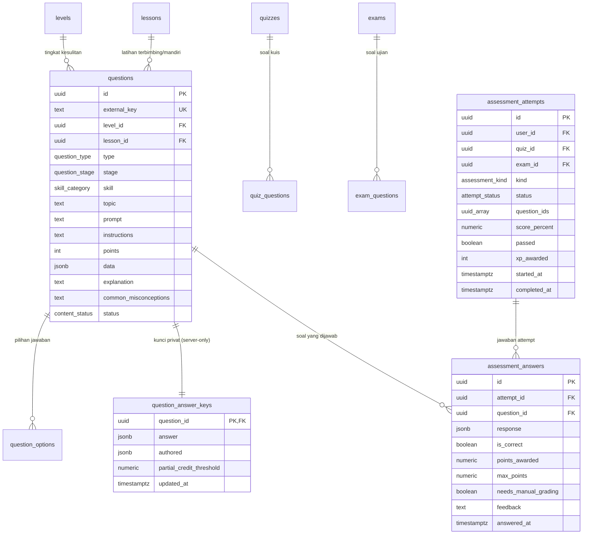
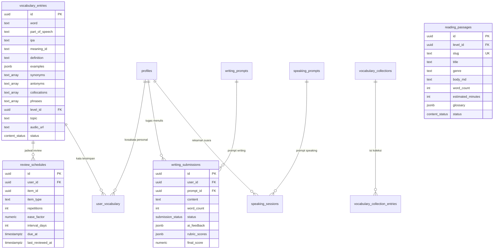
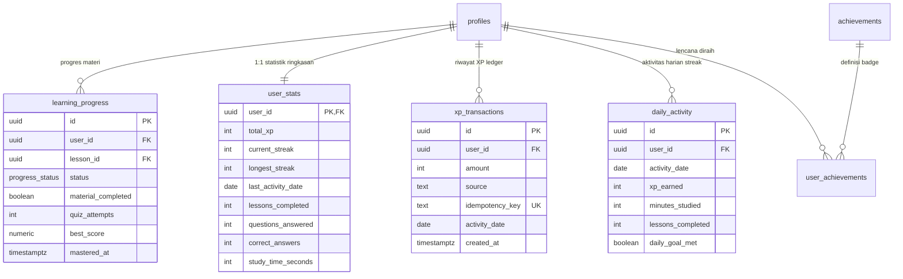

# Entity-Relationship Diagram (ERD) & Database Architecture — Linguora

Dokumen ini memuat spesifikasi relasional, kamus data, diagram entitas-relasi (Mermaid), model keamanan Row Level Security (RLS), dan strategi indeks database Linguora berbasis Supabase PostgreSQL.

---

## 1. Arsitektur Database & Segregasi Data

Database Linguora dirancang ternormalisasi tinggi dengan 7 modul domain utama:
1. **Core & Auth**: Profil pengguna, sistem role berbasis rank, permission matrix, dan audit logging.
2. **Curriculum Engine**: Jalur belajar (CEFR A1–C2), track pembelajaran, course, unit, lesson berstruktur 12 seksi, dan dependency prerequisites.
3. **Assessment & Question Bank**: 20 tipe soal interaktif, pemisahan kunci jawaban privat (`question_answer_keys`) dari data soal publik, kuis, ujian unit, ujian level, attempt, dan jawaban tersimpan.
4. **Skills & Knowledge Labs**: Kosakata (IPA, makna, kolokasi), spaced repetition queue (SM-2/leitner), grammar syllabus, teks reading, materi listening, prompt speaking, dan prompt writing berskala rubrik.
5. **Gamification & Progress Tracking**: Status penguasaan materi, akumulasi XP atomik dengan idempotency key, perhitungan streak berbasis timezone, badges, quests harian, dan leaderboard snapshot.
6. **Study Productivity & AI Tutor**: Study planner, sesi belajar, catatan, bookmark, dan sesi percakapan AI tutor dengan rate-limiting.
7. **CMS & Audit Trail**: Versioning konten dengan snapshot JSONB, changelog, dan rollback capabilities.

---

## 2. Diagram Hubungan Entitas (Mermaid)

### 2.1 Core Identity & Authorization

### 2.2 Kurikulum & Lesson Engine

### 2.3 Assessment Engine & Bank Soal

### 2.4 Skills Labs & Spaced Repetition (SRS)

### 2.5 Gamifikasi & Metrik Progres

---

## 3. Kamus Data & Batasan (Constraints)

| Tabel | Primary Key | Foreign Keys / Index Penting | Aturan & Constraints |
|---|---|---|---|
| `profiles` | `id` (UUID) | `auth.users(id)` ON DELETE CASCADE | `username ~ '^[a-z0-9_]{3,24}$'`, `daily_goal_xp BETWEEN 10 AND 500` |
| `roles` | `role` (enum) | - | `rank SMALLINT UNIQUE` (super_admin=100, admin=80, editor=60, reviewer=50, student=10) |
| `user_roles` | `id` (UUID) | `profiles(id)`, `roles(role)` | UNIQUE (`user_id`, `role`) |
| `lessons` | `id` (UUID) | `units(id)` ON DELETE CASCADE | `slug` UNIQUE, `estimated_minutes BETWEEN 1 AND 240` |
| `lesson_sections` | `id` (UUID) | `lessons(id)` ON DELETE CASCADE | 12 macam `lesson_section_kind` |
| `questions` | `id` (UUID) | `levels(id)`, `lessons(id)` | `points >= 1`, 20 macam `question_type` |
| `question_answer_keys` | `question_id` (UUID) | `questions(id)` ON DELETE CASCADE | Kunci privat terpisah dari tabel `questions` untuk RLS |
| `assessment_attempts` | `id` (UUID) | `profiles(id)`, `quizzes(id)`, `exams(id)` | Status: `in_progress`, `graded`, `abandoned` |
| `xp_transactions` | `id` (UUID) | `profiles(id)` | `idempotency_key` UNIQUE mencegah duplikasi XP |
| `user_stats` | `user_id` (UUID) | `profiles(id)` | Trigger otomatis memperbarui akumulasi saat XP bertambah |

---

## 4. Model Keamanan & Kebijakan Row Level Security (RLS)

1. **Prinsip Least Privilege**: Semua tabel mengaktifkan `ALTER TABLE ... ENABLE ROW LEVEL SECURITY`.
2. **Isolasi Data Pembelajar**:
   - `assessment_attempts`, `assessment_answers`, `xp_transactions`, `user_stats`, `learning_progress`, `user_vocabulary`, `review_schedules`, `notes`, `bookmarks`: Hanya pemilik baris (`auth.uid() = user_id`) yang dapat membaca.
   - Penulisan skor, XP, progress, dan unlock diblokir dari manipulasi langsung client (`WITH CHECK (false)`); seluruh mutasi wajib melalui PostgreSQL Stored Functions berhak istimewa (`SECURITY DEFINER`).
3. **Penyembunyian Kunci Jawaban**:
   - Tabel `question_answer_keys` membatasi akses SELECT hanya untuk staf yang memiliki peran reviewer/admin/super_admin. Siswa/pengguna publik **tidak memiliki izin SELECT sama sekali**. Jawaban diperiksa di server via fungsi `evaluate_attempt_answers`.
4. **Penguncian Materi (Progression Guard)**:
   - SELECT pada `lesson_sections` diatur RLS agar memeriksa fungsi `lesson_accessible_for(auth.uid(), lesson_id)`. Siswa tidak dapat mengintip isi materi lesson yang prasyaratnya belum terpenuhi.
5. **CMS & Role-Based Access Control**:
   - Pengguna dengan peran `content_editor` hanya dapat membuat konten dengan status `draft` atau `in_review`.
   - Mengubah status menjadi `published` memicu trigger pemeriksaan izin `content.publish`.

---

## 5. Strategi Pengindeksan & Optimasi Kueri

- **B-Tree Indexes**: Seluruh foreign key (`user_id`, `lesson_id`, `unit_id`, `course_id`, `level_id`) memiliki indeks B-tree untuk menjamin performa JOIN dan cascade DELETE.
- **Unique Indexes**: Mengamankan integritas slug, username, idempotency key XP, serta pasangan unik relasi (`lesson_prerequisites`, `role_permissions`, `user_roles`).
- **Composite Indexes**:
  - `assessment_attempts(user_id, status, created_at DESC)` untuk pagination riwayat ujian cepat.
  - `review_schedules(user_id, due_at)` untuk polling antrean SRS yang efisien.
  - `daily_activity(user_id, activity_date DESC)` untuk komputasi streak instan.
- **Trigram & Text Search**:
  - Ekstensi `pg_trgm` diaktifkan untuk pencarian fuzzy pada kamus kosakata (`vocabulary_entries.word`) dan bank soal (`questions.prompt`).
